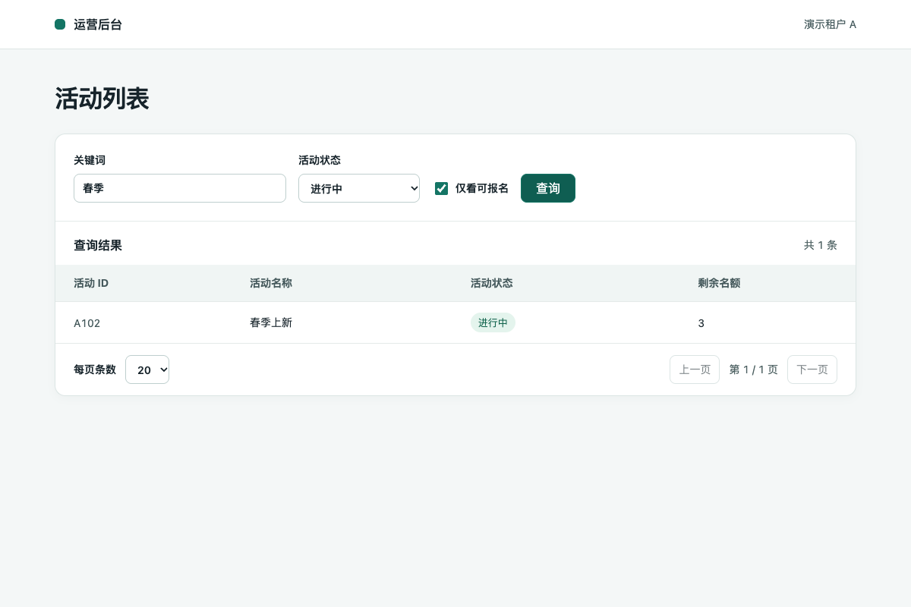

# init_mono 跨仓协作脚手架

从一个工作区接手多个业务仓，用同一份契约推进一个 feature，再用各仓的实际受测版本做联合验收。每个业务仓保留自己的 Git 历史、分支、评审和发布流程。

如果团队用 [STDD/SDD](https://github.com/zhgqwx-del/stdd-sdd) 管理单仓开发，推荐先在业务仓使用 STDD，再用 Mono 把前端、后端等仓组织起来。Mono 也能接入普通 Git 仓库。仓内具备 STDD 模板和技能时，可以直接调用原生模板、关联变更并沿用仓内流程。

- [下载最新版 init_mono.zip](https://github.com/zhgqwx-del/init-mono/releases/latest/download/init_mono.zip)
- [团队快速上手](QUICKSTART.md)
- [实践手册](docs/practice.md)
- [示例说明](examples/README.md)
- [版本记录](https://github.com/zhgqwx-del/init-mono/releases)

## 两层怎么分工

| 层级 | 保存什么 | 日常入口 |
|---|---|---|
| 各业务仓的 STDD/SDD | 本仓规格、变更文档、测试结果、评审和归档 | 本仓 AGENTS.md 与 stdd-* 技能 |
| Mono 协作工作区 | 项目关系、共同契约、任务工作树、联合验收和发布依赖 | init_mono、mono-start、mono-verify、mono-wrap |

初始化一次，之后按 feature 选择用到的仓库。GitHub/GitLab 地址独立 clone，本地 Git 根目录通过 worktree 接入，普通资料目录登记为参考入口。要追加项目，使用 scripts/mono.py add。完整的输入格式见[初始化说明](.agents/skills/init_mono/references/inputs.md)。

## 选一个示例

- [现有 STDD 仓库接入与登录需求](examples/stdd-feature/README.md)适合手头已有前后端项目，想用一张 Mono 工单关联各仓 STDD 变更。
- [前端加两个后端的可运行演练](examples/three-services/README.md)自带合成数据和三个仓库的旧代码，展示基线通过、新验收失败、实现及复跑的全过程。[验收结果](examples/three-services/evidence/result.json)
- [只建立协作流程](examples/process-only.json)适合先梳理系统关系、联调方式和角色分工，代码接入后再推进 feature。

## 维护与验证

在仓库根目录使用 Python 3.9+ 和 Git 运行脚手架测试与打包核对。

~~~sh
python3 -B -m unittest discover -s tests -v
python3 -B scripts/package_skill.py --check
~~~

三仓演练的 HTTP 测试使用 Python 实际启动服务。浏览器验收还需要 Node、Playwright 和 Chromium。GitHub Actions 复跑单元测试、打包校验和三仓演练。[GitHub Actions](https://github.com/zhgqwx-del/init-mono/actions) · [发布步骤](docs/github.md) · [方法来源与覆盖范围](.agents/skills/init_mono/references/method.md)
